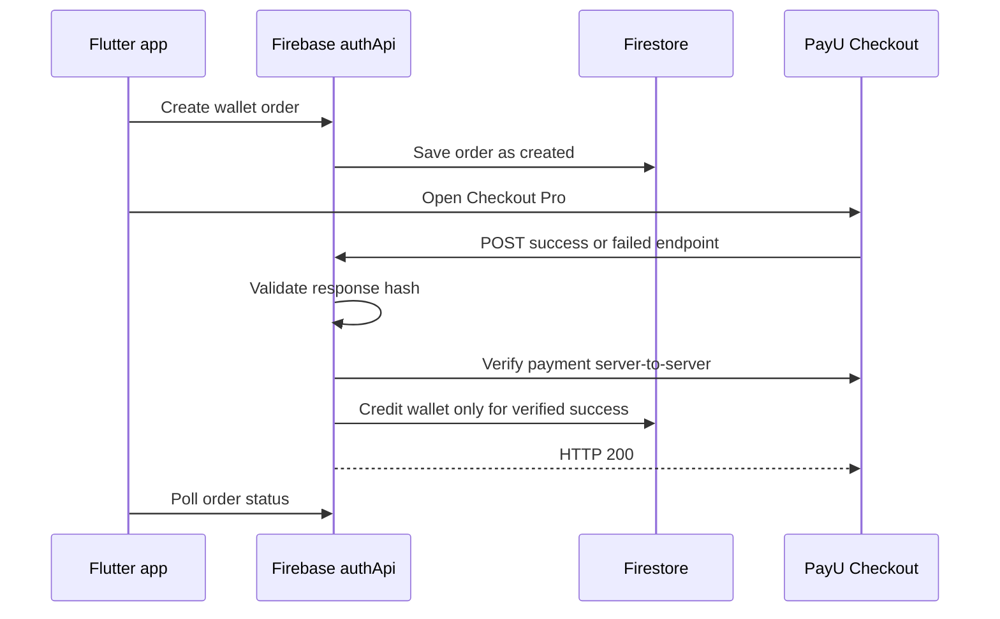
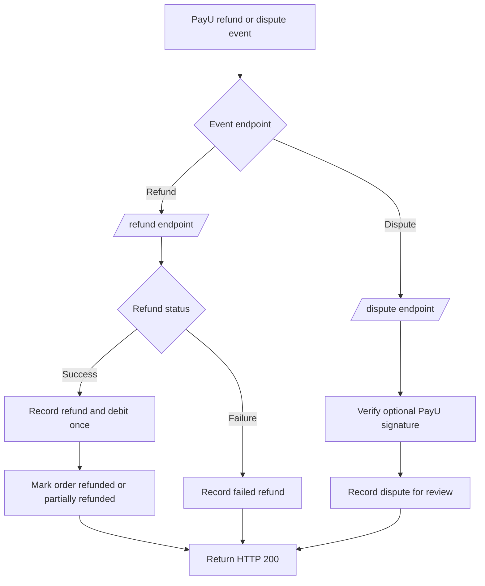

# PayU Payment Webhook Flow

AutoIntel uses three dedicated PayU webhook URLs:

```text
Successful payment:
POST https://asia-south1-autointel-ai-app.cloudfunctions.net/authApi/v1/webhooks/payu/success

Failed payment:
POST https://asia-south1-autointel-ai-app.cloudfunctions.net/authApi/v1/webhooks/payu/failed

Refund:
POST https://asia-south1-autointel-ai-app.cloudfunctions.net/authApi/v1/webhooks/payu/refund

Dispute:
POST https://asia-south1-autointel-ai-app.cloudfunctions.net/authApi/v1/webhooks/payu/dispute
```

## Payment flow



Successful and failed payment payloads are form URL-encoded. The success
endpoint accepts only `status=success`; the failed endpoint accepts only
`status=failure`. Both verify the response hash and call PayU's Verify Payment
API before updating the order.

## Refund and dispute flow



Refunds are stored in `payu_refunds/{request_id}` and disputes in
`payu_disputes/{cb_id}`. Successful refunds create an idempotent wallet debit
ledger entry. Disputes are recorded for review and are not automatically
debited because PayU may debit a chargeback at different stages depending on
the merchant's arrangement.

## PayU Dashboard setup

1. Open PayU Dashboard -> Developers -> Webhooks.
2. Select Payments and create a **Successful** webhook using the `/success`
   URL.
3. Create a **Failed** webhook using the `/failed` URL.
4. Create a **Refund** webhook using the `/refund` URL.
5. Create a **Dispute** webhook using the `/dispute` URL.
6. Save each webhook and use PayU's test webhook action where available.
7. Confirm every endpoint returns HTTP `200`.

PayU sends refund and dispute payloads as JSON. When PayU sends
`X-PayU-Dispute-Webhook-Signature-V2` or V1, the dispute signature is verified.

## Security and idempotency

Keep `PAYU_MERCHANT_KEY` and `PAYU_MERCHANT_SALT` in Firebase Secret Manager.
Never put the salt in Flutter code or Git. Repeated success, refund, or dispute
events are safely deduplicated by their PayU IDs.

PayU documentation:

- [Create a PayU webhook](https://docs.payu.in/docs/create-a-new-webhook)
- [Webhook events and sample payloads](https://docs.payu.in/docs/webhook-events-and-sample-payloads)
- [Webhooks for chargeback](https://docs.payu.in/docs/webhooks-for-chargeback)
- [Production integration checklist](https://docs.payu.in/docs/integration-checklist-merchant-hosted-checkout)
